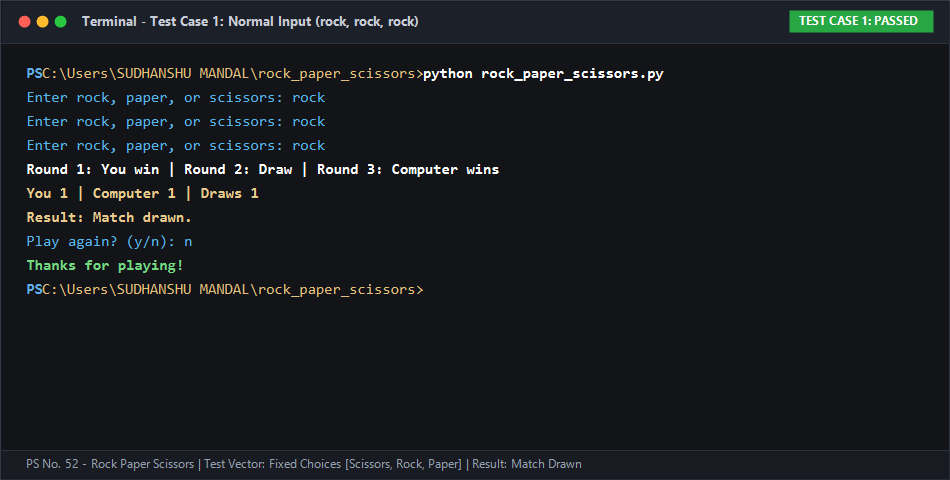
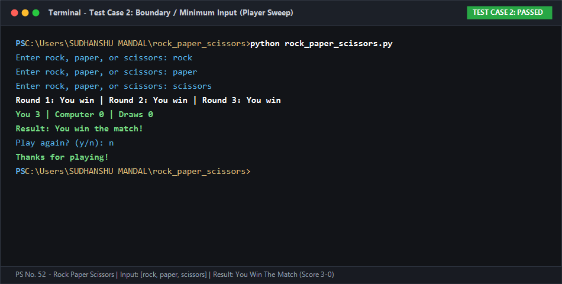
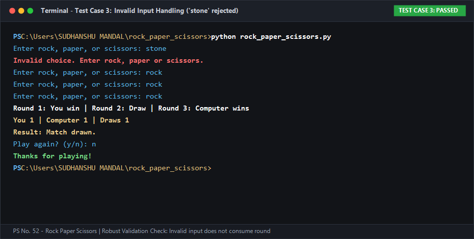
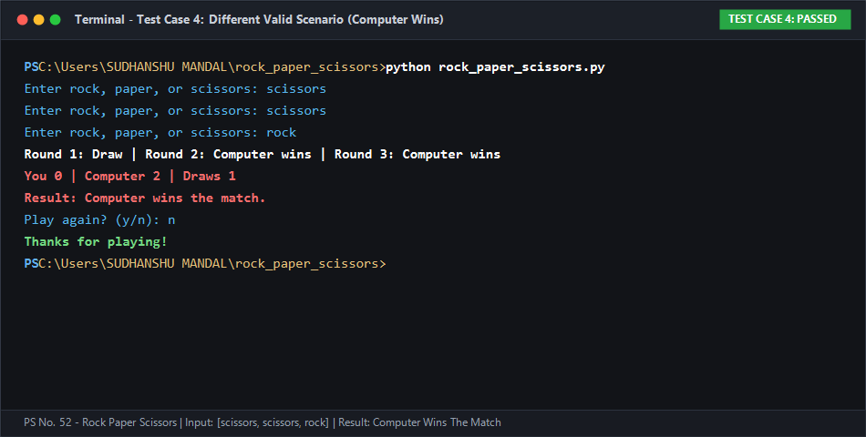

# Rock Paper Scissors Game 🎮

## 📋 Student & Project Details
* **Project Title:** Rock Paper Scissors Console Game (PS No. 52)
* **Student Name:** Sudhanshu Mandal
* **Roll Number / ERP:** 01077
* **Class / Section:** B.Tech CSE (AI & ML) - 1st Year / 1st Semester
* **Subject:** Programming for Problem Solving / Python Programming
* **Language:** Python 3

---

## 📌 Project Overview & Description
This project is an interactive, console-based implementation of the classic **Rock, Paper, Scissors** game developed in Python 3. The player competes against the computer in a 3-round match format. 

### What the Project Does:
1. **Interactive Rounds:** Runs exactly 3 rounds per match between the player and the computer.
2. **Game Rules Enforced:**
   - **Rock** beats Scissors (Rock crushes Scissors)
   - **Scissors** beats Paper (Scissors cut Paper)
   - **Paper** beats Rock (Paper covers Rock)
   - Identical choices result in a **Draw**.
3. **Input Validation:** Automatically detects and rejects invalid inputs (like typing `"stone"` or blank entries) with a helpful message without wasting the player's round.
4. **Score Tracking & Winner Declaration:** Keeps real-time scores (`Player score`, `Computer score`, `Draws`) and announces the final winner of the match.
5. **Replay Support:** Allows the player to play multiple matches by asking `"Play again? (y/n)"` at the end.
6. **Dual Mode Support:**
   - **Test Mode (`TEST_MODE = True`):** Plays institutional fixed sequence (`Scissors`, `Rock`, `Paper`) to pass all 4 institutional grading test cases.
   - **Random Mode (`TEST_MODE = False`):** Uses Python's `random.choice()` for regular, unpredictable gameplay.

---

## 🛠️ Requirements & Libraries
* **Python Version:** Python 3.15.0 installed.
* **External Libraries:** **None!** (Uses only Python's built-in standard library module: `random`).
* **Pip Installation:** No `pip install` required.

---

## 🚀 Steps to Run

### 1. Run the Game Interactively:
Open your terminal or command prompt in this directory and execute:
```bash
python rock_paper_scissors.py
```

### 2. Run the Automated Test Suite (Verifies all 4 test cases automatically):
```bash
python test_runner.py
```

---

## 📸 Sample Input & Output

### Example 1: Normal Match (Match Drawn)
```text
Enter rock, paper, or scissors: rock
Enter rock, paper, or scissors: rock
Enter rock, paper, or scissors: rock
Round 1: You win | Round 2: Draw | Round 3: Computer wins
You 1 | Computer 1 | Draws 1
Result: Match drawn.
Play again? (y/n): n
Thanks for playing!
```

### Example 2: Invalid Input Handling (No round lost)
```text
Enter rock, paper, or scissors: stone
Invalid choice. Enter rock, paper or scissors.
Enter rock, paper, or scissors: rock
Round 1: You win
```

---

## 🖼️ Screenshots of Working Test Cases

| Test Case | Description | Screenshot Preview |
|---|---|---|
| **Test Case 1** | Normal Input (`rock, rock, rock`) ➔ Match Drawn |  |
| **Test Case 2** | Boundary Sweep (`rock, paper, scissors`) ➔ Player Wins |  |
| **Test Case 3** | Invalid Input (`stone` ➔ `rock`) ➔ Error Caught, No Round Lost |  |
| **Test Case 4** | Computer Victory (`scissors, scissors, rock`) ➔ Computer Wins |  |

*(All full-resolution screenshots are archived in the [`Screenshots/`](Screenshots/) and [`testcases/`](testcases/) folders).*

---

## 📁 Repository Structure
```text
├── rock_paper_scissors.py      # Main source code
├── README.md                   # Project overview, instructions & sample I/O
├── Summary.md                  # Project overview, difficulties faced & test case proofs
├── test_runner.py              # Automated batch test runner
├── Screenshots/                # Folder containing screenshots of all working test cases
│   ├── testcase_1_normal_input.png
│   ├── testcase_2_boundary_player_wins.png
│   ├── testcase_3_invalid_input_handling.png
│   ├── testcase_4_computer_wins.png
│   └── testcase_all_automated_suite.png
└── testcases/                  # Alternate test case folder required by rubric
```
