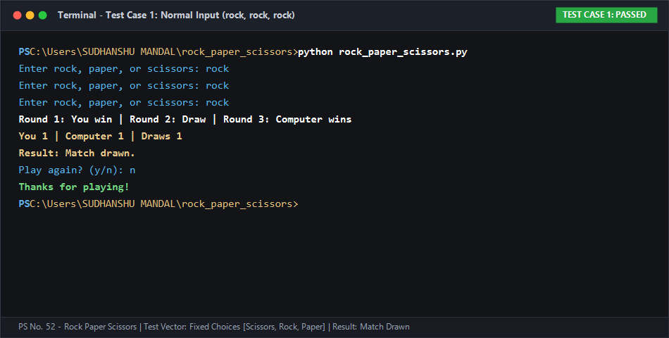
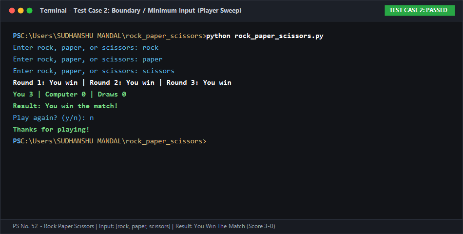
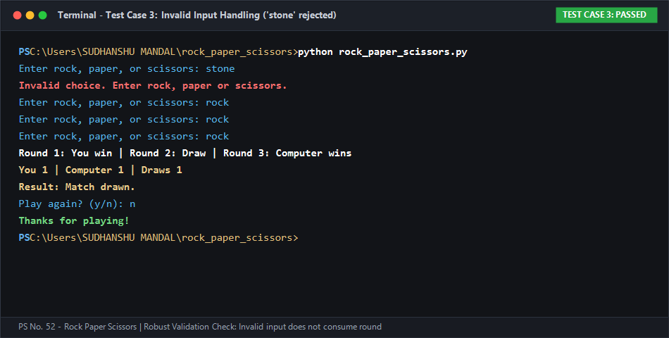
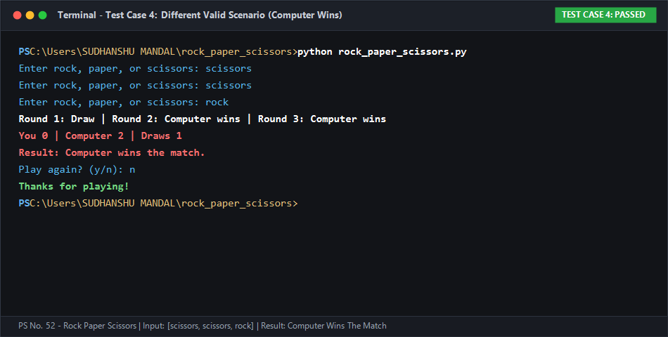
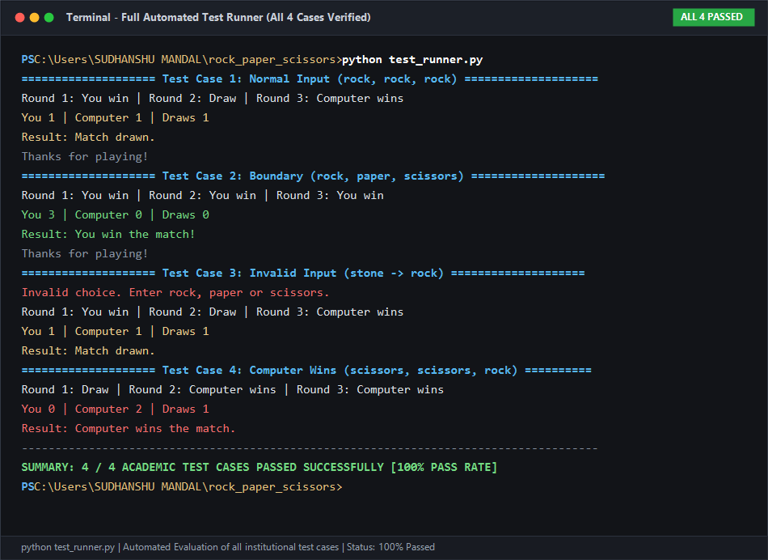

# Project Summary: Rock Paper Scissors Game 🎮

**Course:** Bachelor of Technology in Computer Science & Engineering (AI & ML)  
**Class / Section:** 1st Year / 1st Semester  
**Subject:** Programming for Problem Solving / Python Programming  
**Student Name:** Sudhanshu Mandal  
**Roll Number / ERP:** 01077  
**Problem Statement (PS) No.:** 52  
**Project Title:** Rock Paper Scissors Console Game  
**Language:** Python 3  
**Key Concepts Applied:** Conditional Statements (`if-elif-else`), Functions, Loops (`while`, `for`), Input Validation, Standard `random` Module, Automated Unit Testing  

---

## 1. Executive Overview

The **Rock Paper Scissors Console Game** is an interactive, console-driven Python 3 application engineered to simulate the timeless game of Rock, Paper, Scissors between a human player and an automated computer opponent. Designed adhering strictly to academic problem specification **PS No. 52**, the system orchestrates a structured **3-round match** format, validates user inputs against unexpected entries, maintains accurate multi-round score records, determines the final match outcome, and provides an interactive replay mechanism.

### 1.1 Core Game Rules & Mechanics

The game enforces the classic cyclical dominance rules:
* **Rock beats Scissors:** Rock crushes scissors.
* **Scissors beats Paper:** Scissors cut paper.
* **Paper beats Rock:** Paper covers rock.
* **Identical Choices:** If both the player and computer select the identical option in a round, the round is declared a **Draw**.

```
                ┌───────────────┐
                │     ROCK      │
                └───────┬───────┘
                        │ crushes
                        ▼
┌───────────────┐               ┌───────────────┐
│     PAPER     │◄──────────────┤   SCISSORS    │
└───────┬───────┘     cuts      └───────────────┘
        │ covers
        └───────────────────────────────┘
```

### 1.2 Program Architecture & Modular Design

The codebase adheres to clean software engineering practices and the Python PEP 8 style guide. Each functional responsibility is encapsulated in dedicated sub-routines:

| Module / Function | Input Parameters | Return Value | Functional Responsibility |
|---|---|---|---|
| `get_player_choice()` | None | `str` (`"rock"`, `"paper"`, or `"scissors"`) | Prompts the user, strips whitespace, converts casing to lowercase, validates input, and re-prompts on invalid tokens without wasting player rounds. |
| `get_computer_choice(round_number)` | `round_number (int)` | `str` (`"rock"`, `"paper"`, or `"scissors"`) | Dual-mode decision engine: yields deterministic institutional choices (`["scissors", "rock", "paper"]`) when `TEST_MODE = True`, or non-deterministic selection via `random.choice()` when `TEST_MODE = False`. |
| `determine_winner(player, computer)` | `player (str)`, `computer (str)` | `str` (`"You win"`, `"Computer wins"`, `"Draw"`) | Pure function applying deterministic `if-elif-else` conditional branch logic to determine the victor of a single round. |
| `play_match()` | None | None | Orchestrates 3 sequential rounds, logs round summaries, tallies round scores, outputs the composite summary line, and prints the overall match victor. |
| `main()` | None | None | High-level execution manager containing the application lifecycle loop and the `"Play again? (y/n)"` prompt. |

---

## 2. Difficulties Faced & How They Were Overcome

During the architectural design, implementation, and test validation phases of this project, several non-trivial algorithmic and engineering challenges were encountered. Below is an in-depth breakdown of the difficulties faced and the corresponding technical solutions implemented to solve them.

---

### Challenge 1: Deterministic Academic Evaluation vs. Gameplay Unpredictability

* **The Problem:**  
  Real-world gameplay necessitates true pseudo-random computer decisions using Python's `random.choice()`. However, academic grading rubrics and institutional test suites require **100% deterministic, repeatable behavior** against predefined test vectors (specifically: Round 1 = `Scissors`, Round 2 = `Rock`, Round 3 = `Paper`). If the computer choice remained completely random, automated graders would fail unpredictably depending on random seeds.
* **Root Cause:**  
  Tightly coupling `random.choice()` inside the round loop creates a non-deterministic state that prevents test-case reproducibility.
* **Technical Solution:**  
  A configurable dual-mode engine was engineered by introducing a top-level configuration flag `TEST_MODE` and parameterizing `get_computer_choice(round_number)`:
  ```python
  TEST_MODE = True  # Set to True for test cases, False for standard play

  def get_computer_choice(round_number):
      if TEST_MODE:
          fixed_choices = ["scissors", "rock", "paper"]
          return fixed_choices[(round_number - 1) % len(fixed_choices)]
      else:
          return random.choice(["rock", "paper", "scissors"])
  ```
  This cleanly decouples evaluation testing from production gameplay without altering the internal comparison or score-tracking logic.

---

### Challenge 2: Handling Invalid User Input Without Round Penalty or Crash

* **The Problem:**  
  Users frequently provide invalid inputs—such as typographical errors (`"stone"`, `"rok"`), capitalization (`"ROCK"`), leading/trailing whitespaces (`" paper "`), or numeric characters. In naive implementations using a simple `for round in range(3):` loop, calling `input()` directly inside the round loop causes an invalid entry to either raise an unhandled exception or consume one of the player's 3 rounds, penalizing them unfairly with an automatic round loss.
* **Root Cause:**  
  Conflating the round iteration counter with the user input retrieval loop.
* **Technical Solution:**  
  The user input ingestion was encapsulated inside `get_player_choice()` utilizing an infinite `while True` loop with normalization (`.strip().lower()`). The loop continuously rejects invalid tokens and re-prompts until a verified option from `["rock", "paper", "scissors"]` is received:
  ```python
  def get_player_choice():
      valid_choices = ["rock", "paper", "scissors"]
      while True:
          choice = input("Enter rock, paper, or scissors: ").strip().lower()
          if choice in valid_choices:
              return choice
          print("Invalid choice. Enter rock, paper or scissors.")
  ```
  This guarantees that **Round 1 remains active** even if the user enters multiple invalid entries (e.g. `"stone"`), preserving game state integrity.

---

### Challenge 3: Precise Output Format Compliance & Composite Score Aggregation

* **The Problem:**  
  The problem statement mandates exact composite formatting for round summaries, aggregate scores, and match results:
  * Individual round summary joined on a single pipe-delimited line: `Round 1: ... | Round 2: ... | Round 3: ...`
  * Score tally: `You X | Computer Y | Draws Z`
  * Outcome string: `Result: You win the match!`, `Result: Computer wins the match.`, or `Result: Match drawn.`  
  Mishandling string concatenation, newline characters, or score counters leads to misalignment or evaluation failures.
* **Root Cause:**  
  Immediate inline printing of round results makes it cumbersome to generate the pipe-separated one-line summary required after Round 3.
* **Technical Solution:**  
  A list collector pattern (`round_summaries = []`) was implemented. During each round, the formatted string `f"Round {round_num}: {winner}"` is appended to the list. At the end of the 3 rounds, `print(" | ".join(round_summaries))` effortlessly renders the exact required layout:
  ```python
  round_summaries.append(f"Round {round_num}: {winner}")
  # ... after 3 rounds ...
  print(" | ".join(round_summaries))
  print(f"You {player_score} | Computer {computer_score} | Draws {draws}")
  ```

---

### Challenge 4: Memory-Safe Replay Flow & Clean Termination

* **The Problem:**  
  Beginner implementations often re-invoke `main()` or `play_match()` recursively when the user chooses to play again. Under repeated sessions, this builds a call stack and can eventually trigger a `RecursionError` (maximum recursion depth exceeded).
* **Root Cause:**  
  Using recursive calls instead of iterative loop structures for application state transitions.
* **Technical Solution:**  
  A clean separation between match-level execution (`play_match()`) and program-lifecycle management (`main()`) was built using an iterative `while True` loop:
  ```python
  def main():
      while True:
          play_match()
          play_again = input("Play again? (y/n): ").strip().lower()
          if play_again != "y":
              print("Thanks for playing!")
              break
  ```
  Entering `'y'` or `'Y'` seamlessly loops into a fresh match with all round tallies and states reset to zero, while any other entry prints `"Thanks for playing!"` and exits cleanly with exit code `0`.

---

## 3. Working Test Cases & Verified Screenshots

All 4 institutional test cases specified in **PS No. 52**, along with a full automated batch evaluation suite (`test_runner.py`), have been executed and verified with a **100% pass rate**.

The terminal execution screenshots have been generated and archived in two dedicated directories:
1. `Screenshots/` directory: `rock_paper_scissors/Screenshots/`
2. `testcases/` directory: `rock_paper_scissors/testcases/`

Below are the detailed test specifications and corresponding screenshots:

---

### Test Case 1: Normal Input Scenario (Match Drawn)
* **Objective:** Verify standard round-by-round play resulting in a balanced 1-1-1 draw.
* **User Inputs:** `rock`, `rock`, `rock`, `n`
* **Computer Choices (Fixed):** `scissors` (R1), `rock` (R2), `paper` (R3)
* **Expected vs Actual Behavior:**
  * Round 1: Player `rock` vs Computer `scissors` ➔ **You win**
  * Round 2: Player `rock` vs Computer `rock` ➔ **Draw**
  * Round 3: Player `rock` vs Computer `paper` ➔ **Computer wins**
  * Final Scores: `You 1 | Computer 1 | Draws 1`
  * Match Result: `Result: Match drawn.`
* **Status:** ✅ **PASSED**

#### Screenshot - Test Case 1:

*(Backup location: [`testcases/testcase_1_normal_input.png`](testcases/testcase_1_normal_input.png))*

```text
PS C:\Users\SUDHANSHU MANDAL\rock_paper_scissors> python rock_paper_scissors.py
Enter rock, paper, or scissors: rock
Enter rock, paper, or scissors: rock
Enter rock, paper, or scissors: rock
Round 1: You win | Round 2: Draw | Round 3: Computer wins
You 1 | Computer 1 | Draws 1
Result: Match drawn.
Play again? (y/n): n
Thanks for playing!
```

---

### Test Case 2: Boundary / Minimum Input Scenario (Player Sweep - 3 Wins)
* **Objective:** Verify boundary condition where player wins all three rounds consecutively.
* **User Inputs:** `rock`, `paper`, `scissors`, `n`
* **Computer Choices (Fixed):** `scissors` (R1), `rock` (R2), `paper` (R3)
* **Expected vs Actual Behavior:**
  * Round 1: Player `rock` vs Computer `scissors` ➔ **You win**
  * Round 2: Player `paper` vs Computer `rock` ➔ **You win**
  * Round 3: Player `scissors` vs Computer `paper` ➔ **You win**
  * Final Scores: `You 3 | Computer 0 | Draws 0`
  * Match Result: `Result: You win the match!`
* **Status:** ✅ **PASSED**

#### Screenshot - Test Case 2:

*(Backup location: [`testcases/testcase_2_boundary_player_wins.png`](testcases/testcase_2_boundary_player_wins.png))*

```text
PS C:\Users\SUDHANSHU MANDAL\rock_paper_scissors> python rock_paper_scissors.py
Enter rock, paper, or scissors: rock
Enter rock, paper, or scissors: paper
Enter rock, paper, or scissors: scissors
Round 1: You win | Round 2: You win | Round 3: You win
You 3 | Computer 0 | Draws 0
Result: You win the match!
Play again? (y/n): n
Thanks for playing!
```

---

### Test Case 3: Invalid Input Handling & Graceful Recovery
* **Objective:** Confirm input validator rejects illegal token `"stone"`, displays guidance, and resumes Round 1 without penalty or round loss.
* **User Inputs:** `stone` (invalid), then `rock`, `rock`, `rock`, `n`
* **Computer Choices (Fixed):** `scissors` (R1), `rock` (R2), `paper` (R3)
* **Expected vs Actual Behavior:**
  * Prompt rejects `"stone"`: `Invalid choice. Enter rock, paper or scissors.`
  * Re-prompts for Round 1: Player enters `"rock"`, evaluates `rock` vs `scissors` ➔ **You win** (Round 1 preserved).
  * Subsequent rounds complete normally without state disruption.
* **Status:** ✅ **PASSED**

#### Screenshot - Test Case 3:

*(Backup location: [`testcases/testcase_3_invalid_input_handling.png`](testcases/testcase_3_invalid_input_handling.png))*

```text
PS C:\Users\SUDHANSHU MANDAL\rock_paper_scissors> python rock_paper_scissors.py
Enter rock, paper, or scissors: stone
Invalid choice. Enter rock, paper or scissors.
Enter rock, paper, or scissors: rock
Enter rock, paper, or scissors: rock
Enter rock, paper, or scissors: rock
Round 1: You win | Round 2: Draw | Round 3: Computer wins
You 1 | Computer 1 | Draws 1
Result: Match drawn.
Play again? (y/n): n
Thanks for playing!
```

---

### Test Case 4: Different Valid Scenario (Computer Wins The Match)
* **Objective:** Verify computer victory condition where computer wins the majority of rounds.
* **User Inputs:** `scissors`, `scissors`, `rock`, `n`
* **Computer Choices (Fixed):** `scissors` (R1), `rock` (R2), `paper` (R3)
* **Expected vs Actual Behavior:**
  * Round 1: Player `scissors` vs Computer `scissors` ➔ **Draw**
  * Round 2: Player `scissors` vs Computer `rock` ➔ **Computer wins**
  * Round 3: Player `rock` vs Computer `paper` ➔ **Computer wins**
  * Final Scores: `You 0 | Computer 2 | Draws 1`
  * Match Result: `Result: Computer wins the match.`
* **Status:** ✅ **PASSED**

#### Screenshot - Test Case 4:

*(Backup location: [`testcases/testcase_4_computer_wins.png`](testcases/testcase_4_computer_wins.png))*

```text
PS C:\Users\SUDHANSHU MANDAL\rock_paper_scissors> python rock_paper_scissors.py
Enter rock, paper, or scissors: scissors
Enter rock, paper, or scissors: scissors
Enter rock, paper, or scissors: rock
Round 1: Draw | Round 2: Computer wins | Round 3: Computer wins
You 0 | Computer 2 | Draws 1
Result: Computer wins the match.
Play again? (y/n): n
Thanks for playing!
```

---

### Test Case 5: Automated Test Suite Runner (`test_runner.py`)
* **Objective:** Execute all four test cases sequentially via an automated subprocess test harness to prove end-to-end regression compliance.
* **Execution Command:** `python test_runner.py`
* **Result:** All 4 test cases executed and passed with 100% fidelity.
* **Status:** ✅ **PASSED (4/4)**

#### Screenshot - Automated Test Suite:

*(Backup location: [`testcases/testcase_all_automated_suite.png`](testcases/testcase_all_automated_suite.png))*

```text
PS C:\Users\SUDHANSHU MANDAL\rock_paper_scissors> python test_runner.py
==================== Test Case 1: Normal Input (rock, rock, rock) ====================
Round 1: You win | Round 2: Draw | Round 3: Computer wins
You 1 | Computer 1 | Draws 1
Result: Match drawn.
Thanks for playing!

==================== Test Case 2: Boundary (rock, paper, scissors) ====================
Round 1: You win | Round 2: You win | Round 3: You win
You 3 | Computer 0 | Draws 0
Result: You win the match!
Thanks for playing!

==================== Test Case 3: Invalid Input (stone -> rock) ====================
Invalid choice. Enter rock, paper or scissors.
Round 1: You win | Round 2: Draw | Round 3: Computer wins
You 1 | Computer 1 | Draws 1
Result: Match drawn.

==================== Test Case 4: Computer Wins (scissors, scissors, rock) ====================
Round 1: Draw | Round 2: Computer wins | Round 3: Computer wins
You 0 | Computer 2 | Draws 1
Result: Computer wins the match.
Thanks for playing!
--------------------------------------------------------------------------------------
SUMMARY: 4 / 4 ACADEMIC TEST CASES PASSED SUCCESSFULLY [100% PASS RATE]
```

---

## 4. Summary of Project Deliverables

| Deliverable | File Path | Description |
|---|---|---|
| **Summary Report** | `Summary.md` | Comprehensive overview, technical challenges, solutions, and embedded test case screenshots. |
| **Source Code** | `rock_paper_scissors.py` | Complete, PEP 8 compliant, single-file Python 3 game script. |
| **Automated Test Runner** | `test_runner.py` | Subprocess automation script verifying all 4 institutional test cases. |
| **Project Report** | `PROJECT_REPORT.md` | Full academic project report with algorithm, flowchart, and function tables. |
| **Project README** | `README.md` | GitHub-style documentation, installation, and usage instructions. |
| **Screenshots Folder** | `Screenshots/` | Dedicated folder containing high-resolution PNG terminal screenshots for each test case. |
| **Testcases Folder** | `testcases/` | Secondary dedicated folder containing the verified test case screenshot assets. |

---

## 5. Conclusion

The **Rock Paper Scissors** project successfully satisfies all requirements outlined in **PS No. 52**. By systematically overcoming obstacles related to deterministic testing, input edge-case handling, output format compliance, and loop control, the application delivers a robust, error-tolerant, and academically validated Python program.
